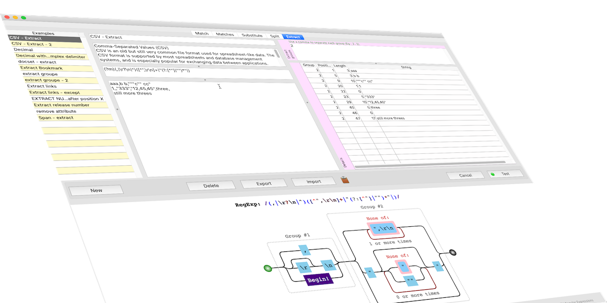

# AJ_Tools_Regex

Réalisé avec Cursor / Grok Bot (Codesky) pour Maurice Inzirillo.
Made with Cursor / Grok Bot (Codesky) for Maurice Inzirillo.

Version 6.0.0 — 4D 21 R4 · [Français](#français) · [English](#english)



---

## Français

AJ_Tools_Regex est un composant 4D qui ajoute des fonctions de texte basées sur les expressions régulières : `match`, `matches`, `substitute`, `split` et `extract`. Il s'appuie sur la commande 4D [`Match regex`](https://developer.4d.com/docs/commands/match-regex) (syntaxe [ICU](https://unicode-org.github.io/icu/userguide/strings/regexp.html)).

Le dépôt contient :

- `AJ_Tools_Regex/` : le composant ;
- `AJ_Tools_RegexLab/` : l'application de test (Regex Lab) ;
- `tests/` : le banc de test du comportement ([tests/README.md](tests/README.md)).

Les changements de chaque version (6.0.0 : classe `Regex` exposée sous `cs.AJRegex`) sont décrits dans [CHANGELOG.md](CHANGELOG.md).

### Installation

**Avec le gestionnaire de dépendances (recommandé).** Dans le projet hôte, déclarez le composant dans `Project/Sources/dependencies.json` :

```json
{
	"dependencies": {
		"AJ_Tools_Regex": {
			"github": "AJARProject/AJ_Tools_Regex",
			"version": "^6.0.0"
		}
	}
}
```

4D télécharge alors l'archive `AJ_Tools_Regex.zip` de la release GitHub correspondante (composant compilé Intel + Apple Silicon, signé ad hoc).

**En local.** Déclarez `"AJ_Tools_Regex": {}` dans `dependencies.json` et placez le dossier `AJ_Tools_Regex` (ou le composant construit `AJ_Tools_Regex.4dbase`) à côté du dossier de votre projet, ou indiquez son chemin dans un fichier `environment4d.json`. Vous pouvez aussi copier `AJ_Tools_Regex.4dbase` dans le dossier `Components` du projet (voir [Composants](https://developer.4d.com/docs/Project/components)).

Pour vérifier la version chargée : `AJ_Tools_Regex_info` retourne `AJ_Tools_Regex (v21 R4) : 6.0.0`.

### Utilisation

`New regex` retourne un objet dont les fonctions reçoivent un objet requête et retournent un objet résultat :

```4d
var $regex; $result : Object
$regex:=New regex
$result:=$regex.match(New object("pattern"; "b+"; "string"; "abbbc"))
// $result.success = True, $result.string_extracted = "bbb", $result.position = 2, $result.length = 3
```

Toutes les fonctions sont « preemptive capable » (utilisables dans un process préemptif) et ne modifient pas l'objet requête. Chaque résultat contient `success` et `listbox`, une collection d'objets `{position; length; group; string_extracted}` utilisable directement comme source d'une list box collection. Les positions commencent à 1. Un groupe qui ne participe pas à une occurrence a `position` -1, `length` 0 et `string_extracted` "".

#### Classe `Regex` (`cs.AJRegex.Regex`)

Depuis la version 6.0.0, le composant expose aussi la classe `Regex` dans le class store de l'hôte, sous le namespace `AJRegex` (Settings > Général > *Component namespace in the class store*). Ses fonctions `match`, `matches`, `substitute`, `split` et `extract` reçoivent les mêmes objets requête et retournent les mêmes résultats que celles de `New regex` :

```4d
var $regex:=cs.AJRegex.Regex.new()
var $result:=$regex.match({pattern: "\\d+"; string: "ab12"})
// $result.success = True, $result.string_extracted = "12", $result.position = 3, $result.length = 2
```

Le constructeur accepte un pattern par défaut, utilisé quand la requête n'a pas d'attribut `pattern` (un `pattern` présent dans la requête reste prioritaire ; la requête n'est pas modifiée) :

```4d
var $digits:=cs.AJRegex.Regex.new("\\d+")
$result:=$digits.matches({string: "a1 b22"})
// $result.string_extracted = ["1";"22"], $result.position = [2;5]
```

Le composant compilé fournit un fichier de syntaxe (`Resources/en.lproj/syntaxEN.json`) pour la complétion de code dans l'hôte.

`New regex` reste disponible et inchangée : le code existant n'a pas besoin d'être modifié.

#### `match` — première occurrence

| Requête | Type | Description |
|---|---|---|
| `pattern` | Texte | Expression régulière |
| `string` | Texte | Texte à analyser |
| `start` | Entier | Position de départ de la recherche (1 par défaut) |
| `position_only` | Booléen | Vrai : l'occurrence doit commencer exactement à `start` |
| `whole_string` | Booléen | Vrai : tout le texte doit correspondre (comportement 5.1.0) |

Résultat : `success` (Booléen), `string_extracted` (Texte, "" si rien), `position` et `length` (Entiers, 0 si rien), `listbox`.

```4d
$result:=$regex.match(New object("pattern"; "(\\d+)-(\\d+)"; "string"; "x 12-34 y"))
// success True, string_extracted "12-34", position 3, length 5
$result:=$regex.match(New object("pattern"; "[:xdigit:]{8}-[:xdigit:]{4}-[:xdigit:]{4}-[:xdigit:]{4}-[:xdigit:]{12}"; "string"; "6C7122D2-8986-41E8-8B3D-D50786486706"; "whole_string"; True))
// success True : tout le texte est un UUID
```

#### `matches` — toutes les occurrences

Requête : `pattern`, `string`, `start` (option), `position_only` (option : chaque occurrence doit suivre directement la précédente).

Résultat : `success`, puis des collections alignées `string_extracted`, `position`, `length`, `group` (pour chaque occurrence : le groupe 0, puis chaque groupe de capture), `listbox`.

```4d
$result:=$regex.matches(New object("pattern"; "(\\d+)-(\\d+)"; "string"; "a 12-34 b 5-6"))
// string_extracted ["12-34";"12";"34";"5-6";"5";"6"], group [0;1;2;0;1;2]
```

#### `substitute` — remplacement

Requête : `pattern`, `string`, `string_for_replacement` (absent ou vide : les occurrences sont supprimées). Le texte de remplacement peut contenir `\0` (occurrence entière), `\1`, `\2`… Le numéro de groupe le plus élevé qui existe est pris d'abord (`\12` = groupe 12 s'il existe, sinon groupe 1 suivi de « 2 ») ; une référence à un groupe inexistant reste telle quelle.

Résultat : `success`, `string_resulting` (Texte), `string_match`, `position`, `length`, `group` (comme `matches`), `listbox`.

```4d
$result:=$regex.substitute(New object("pattern"; "(\\w+) (\\w+)"; "string"; "hello world"; "string_for_replacement"; "\\2 \\1"))
// string_resulting "world hello"
$result:=$regex.substitute(New object("pattern"; "\\d+"; "string"; "a1b22"; "string_for_replacement"; "<\\0>"))
// string_resulting "a<1>b<22>"
```

#### `split` — découpage

Découpe le texte aux délimiteurs trouvés par l'expression. Requête : `pattern`, `string`.

Résultat : `success` (Vrai si au moins un délimiteur est trouvé), `string_extracted` (les morceaux), `position`, `length`, `listbox`. `text_extracted` contient la même chose (déprécié, gardé pour la compatibilité). Sans délimiteur, `success` est Faux et `string_extracted` contient le texte entier.

```4d
$result:=$regex.split(New object("pattern"; "\\s+(AND|OR)\\s+"; "string"; "Maurice AND Javascript OR 4D"))
// string_extracted ["Maurice";"Javascript";"4D"]
```

#### `extract` — extraction de groupes

Requête : `pattern`, `string`, `group` (collection de numéros de groupe, nombres ou textes ; absent ou vide : groupe 0).

Résultat : `success`, `string_extracted`, `position`, `length`, `group`, `listbox`, rangés par groupe demandé.

```4d
$result:=$regex.extract(New object("pattern"; "(\\d+)-(\\d+)"; "string"; "a 12-34 b 5-6"; "group"; New collection(2; 1)))
// string_extracted ["34";"6";"12";"5"], group [2;2;1;1]
$result:=$regex.extract(New object("pattern"; "(\\d+)-(\\d+)"; "string"; "a 12-34 b 5-6"))
// string_extracted ["12-34";"5-6"] (groupe 0)
```

#### Autres méthodes partagées

- `AJ_Tools_Regex_info` → Texte : nom, version de 4D visée et version du composant.
- `Regex_Licence` : affiche la licence MIT dans une fenêtre.

### Regex Lab

`AJ_Tools_RegexLab` sert à essayer des expressions et à générer le code 4D correspondant. Ouvrez `AJ_Tools_RegexLab/Project/AJ_Tools_RegexLab.4DProject` avec 4D 21 R4, puis lancez la méthode `RegexLab_Windows` (menu Fichier > Launch RegexLab5).

- Le Lab charge AJ_Tools_Regex par le gestionnaire de dépendances. Le fichier `AJ_Tools_RegexLab/environment4d.json` pointe sur la copie du dépôt (`../AJ_Tools_Regex`) ; supprimez-le pour utiliser la release GitHub.
- Les exemples sont dans `AJ_Tools_RegexLab/json/regex_examples.json`, les exports dans `AJ_Tools_RegexLab/export/`.
- La zone web affiche l'expression sous forme de diagramme avec [Regulex](https://github.com/CJex/regulex) (licence MIT, © 2014 Jex), copié dans `Resources/visual`.

### Construire le composant

La méthode `AJ_Tools_Regex_Build` (invisible, non partagée) compile le composant puis appelle `BUILD APPLICATION` avec `AJ_Tools_Regex/Settings/buildApp.4DSettings`, ce qui produit `AJ_Tools_Regex/Components/AJ_Tools_Regex.4dbase` (code Intel + Apple Silicon, `target="all"` dans `Project/Sources/settings.4DSettings`). Sans interface : `4D --project AJ_Tools_Regex/Project/AJ_Tools_Regex.4DProject --headless --dataless --startup-method AJ_Tools_Regex_Build` (résultat dans `build_result.txt`). L'archive de release s'appelle `AJ_Tools_Regex.zip` et contient `AJ_Tools_Regex.4dbase`.

### Licence

MIT — © AJAR SA ([LICENSE](LICENSE)). Regulex : MIT, © 2014 Jex.

---

## English

AJ_Tools_Regex is a 4D component that adds text functions based on regular expressions: `match`, `matches`, `substitute`, `split` and `extract`. It relies on the 4D [`Match regex`](https://developer.4d.com/docs/commands/match-regex) command ([ICU](https://unicode-org.github.io/icu/userguide/strings/regexp.html) syntax).

The repository contains:

- `AJ_Tools_Regex/`: the component;
- `AJ_Tools_RegexLab/`: the test application (Regex Lab);
- `tests/`: the behaviour harness ([tests/README.md](tests/README.md)).

The changes of each version (6.0.0: `Regex` class exposed as `cs.AJRegex`) are listed in [CHANGELOG.md](CHANGELOG.md).

### Installation

**With the dependency manager (recommended).** In the host project, declare the component in `Project/Sources/dependencies.json`:

```json
{
	"dependencies": {
		"AJ_Tools_Regex": {
			"github": "AJARProject/AJ_Tools_Regex",
			"version": "^6.0.0"
		}
	}
}
```

4D then downloads the `AJ_Tools_Regex.zip` asset of the matching GitHub release (component compiled for Intel + Apple Silicon, ad hoc signed).

**Locally.** Declare `"AJ_Tools_Regex": {}` in `dependencies.json` and put the `AJ_Tools_Regex` folder (or the built `AJ_Tools_Regex.4dbase`) next to your project folder, or give its path in an `environment4d.json` file. You can also copy `AJ_Tools_Regex.4dbase` into the project's `Components` folder (see [Components](https://developer.4d.com/docs/Project/components)).

To check the loaded version: `AJ_Tools_Regex_info` returns `AJ_Tools_Regex (v21 R4) : 6.0.0`.

### Usage

`New regex` returns an object whose functions take a request object and return a result object:

```4d
var $regex; $result : Object
$regex:=New regex
$result:=$regex.match(New object("pattern"; "b+"; "string"; "abbbc"))
// $result.success = True, $result.string_extracted = "bbb", $result.position = 2, $result.length = 3
```

All functions are preemptive capable (usable in a preemptive process) and leave the request object unchanged. Every result contains `success` and `listbox`, a collection of `{position; length; group; string_extracted}` objects that can be used directly as the source of a collection list box. Positions start at 1. A group that does not take part in an occurrence has `position` -1, `length` 0 and `string_extracted` "".

#### `Regex` class (`cs.AJRegex.Regex`)

Since version 6.0.0, the component also exposes the `Regex` class in the host class store, under the `AJRegex` namespace (Settings > General > *Component namespace in the class store*). Its `match`, `matches`, `substitute`, `split` and `extract` functions take the same request objects and return the same results as the `New regex` ones:

```4d
var $regex:=cs.AJRegex.Regex.new()
var $result:=$regex.match({pattern: "\\d+"; string: "ab12"})
// $result.success = True, $result.string_extracted = "12", $result.position = 3, $result.length = 2
```

The constructor accepts a default pattern, used when the request has no `pattern` attribute (a `pattern` given in the request wins; the request is not modified):

```4d
var $digits:=cs.AJRegex.Regex.new("\\d+")
$result:=$digits.matches({string: "a1 b22"})
// $result.string_extracted = ["1";"22"], $result.position = [2;5]
```

The compiled component ships a syntax file (`Resources/en.lproj/syntaxEN.json`) for code completion in the host.

`New regex` is still available and unchanged: existing code does not need any change.

#### `match` — first occurrence

| Request | Type | Description |
|---|---|---|
| `pattern` | Text | Regular expression |
| `string` | Text | Text to search |
| `start` | Integer | Position where the search starts (default 1) |
| `position_only` | Boolean | True: the occurrence must start exactly at `start` |
| `whole_string` | Boolean | True: the whole text must match (5.1.0 behaviour) |

Result: `success` (Boolean), `string_extracted` (Text, "" when nothing is found), `position` and `length` (Integers, 0 when nothing is found), `listbox`.

```4d
$result:=$regex.match(New object("pattern"; "(\\d+)-(\\d+)"; "string"; "x 12-34 y"))
// success True, string_extracted "12-34", position 3, length 5
$result:=$regex.match(New object("pattern"; "[:xdigit:]{8}-[:xdigit:]{4}-[:xdigit:]{4}-[:xdigit:]{4}-[:xdigit:]{12}"; "string"; "6C7122D2-8986-41E8-8B3D-D50786486706"; "whole_string"; True))
// success True: the whole text is a UUID
```

#### `matches` — all occurrences

Request: `pattern`, `string`, `start` (optional), `position_only` (optional: each occurrence must directly follow the previous one).

Result: `success`, then aligned collections `string_extracted`, `position`, `length`, `group` (for each occurrence: group 0, then each capture group), `listbox`.

```4d
$result:=$regex.matches(New object("pattern"; "(\\d+)-(\\d+)"; "string"; "a 12-34 b 5-6"))
// string_extracted ["12-34";"12";"34";"5-6";"5";"6"], group [0;1;2;0;1;2]
```

#### `substitute` — replacement

Request: `pattern`, `string`, `string_for_replacement` (missing or empty: occurrences are deleted). The replacement text can contain `\0` (whole occurrence), `\1`, `\2`… The highest existing group number is used first (`\12` is group 12 when it exists, otherwise group 1 followed by "2"); a reference to a group that does not exist is kept as is.

Result: `success`, `string_resulting` (Text), `string_match`, `position`, `length`, `group` (as in `matches`), `listbox`.

```4d
$result:=$regex.substitute(New object("pattern"; "(\\w+) (\\w+)"; "string"; "hello world"; "string_for_replacement"; "\\2 \\1"))
// string_resulting "world hello"
$result:=$regex.substitute(New object("pattern"; "\\d+"; "string"; "a1b22"; "string_for_replacement"; "<\\0>"))
// string_resulting "a<1>b<22>"
```

#### `split` — splitting

Splits the text at the delimiters found by the expression. Request: `pattern`, `string`.

Result: `success` (True when at least one delimiter is found), `string_extracted` (the pieces), `position`, `length`, `listbox`. `text_extracted` holds the same thing (deprecated, kept for compatibility). Without a delimiter, `success` is False and `string_extracted` holds the whole text.

```4d
$result:=$regex.split(New object("pattern"; "\\s+(AND|OR)\\s+"; "string"; "Maurice AND Javascript OR 4D"))
// string_extracted ["Maurice";"Javascript";"4D"]
```

#### `extract` — group extraction

Request: `pattern`, `string`, `group` (collection of group numbers, numbers or texts; missing or empty: group 0).

Result: `success`, `string_extracted`, `position`, `length`, `group`, `listbox`, ordered by requested group.

```4d
$result:=$regex.extract(New object("pattern"; "(\\d+)-(\\d+)"; "string"; "a 12-34 b 5-6"; "group"; New collection(2; 1)))
// string_extracted ["34";"6";"12";"5"], group [2;2;1;1]
$result:=$regex.extract(New object("pattern"; "(\\d+)-(\\d+)"; "string"; "a 12-34 b 5-6"))
// string_extracted ["12-34";"5-6"] (group 0)
```

#### Other shared methods

- `AJ_Tools_Regex_info` → Text: name, targeted 4D version and component version.
- `Regex_Licence`: shows the MIT licence in a window.

### Regex Lab

`AJ_Tools_RegexLab` is used to try expressions and generate the matching 4D code. Open `AJ_Tools_RegexLab/Project/AJ_Tools_RegexLab.4DProject` with 4D 21 R4, then run the `RegexLab_Windows` method (File menu > Launch RegexLab5).

- The Lab loads AJ_Tools_Regex with the dependency manager. `AJ_Tools_RegexLab/environment4d.json` points to the repository copy (`../AJ_Tools_Regex`); delete it to use the GitHub release.
- Examples are in `AJ_Tools_RegexLab/json/regex_examples.json`, exports in `AJ_Tools_RegexLab/export/`.
- The web area draws the expression as a diagram with [Regulex](https://github.com/CJex/regulex) (MIT licence, © 2014 Jex), copied in `Resources/visual`.

### Building the component

The `AJ_Tools_Regex_Build` method (invisible, not shared) compiles the component then calls `BUILD APPLICATION` with `AJ_Tools_Regex/Settings/buildApp.4DSettings`, which produces `AJ_Tools_Regex/Components/AJ_Tools_Regex.4dbase` (Intel + Apple Silicon code, `target="all"` in `Project/Sources/settings.4DSettings`). Headless: `4D --project AJ_Tools_Regex/Project/AJ_Tools_Regex.4DProject --headless --dataless --startup-method AJ_Tools_Regex_Build` (result in `build_result.txt`). The release archive is named `AJ_Tools_Regex.zip` and contains `AJ_Tools_Regex.4dbase`.

### Licence

MIT — © AJAR SA ([LICENSE](LICENSE)). Regulex: MIT, © 2014 Jex.
